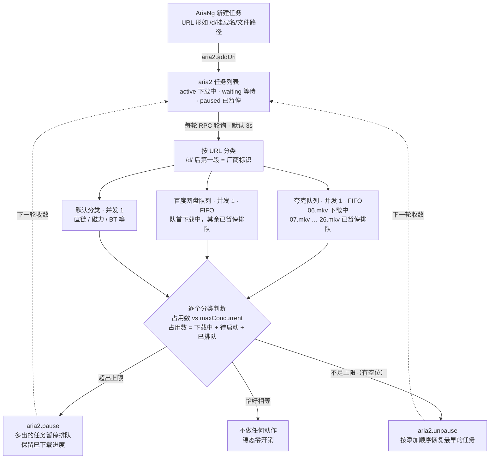

# aria2-vendor-queue

为 aria2 提供按 **网盘厂商（Alist 挂载点）** 划分的独立下载队列。

同一个进程里还跑着第二部分：**夸克网盘「转存窗口」调度器**（`quark_window.py`）——
把"删网盘腾空间 → 网页转存 → 复制直链 → 加 aria2 任务"这条手工流水线全自动闭环，
适用于网盘容量小（如免费号 30G）、单集却 8G 的场景。详见 [夸克转存窗口](#夸克转存窗口quark_window)。

## 解决什么问题

Alist 挂载了多个网盘（夸克、百度网盘、迅雷云盘、阿里云、天翼云盘），各厂商独立限速：

- aria2 全局"最大同时下载数 = 1"：同一时刻只有一个厂商在下载，其他厂商的限速额度被浪费。
- 调大到 2：aria2 的全局队列不区分任务来自哪个厂商，可能同时下载两个夸克任务，速度被厂商限速瓜分（每个 ~50KB/s），也可能出现一夸克一百度（速度叠加）——完全看运气。
- aria2 **没有**"标签/分类 + 按分类限流"的原生能力（实测 1.36.0 `tellStatus` 也读不回任务级 `header` 选项，无法把它当分类元数据用），所以无论怎么调 aria2 或 AriaNg 都解决不了。

**本调度器**利用一个天然事实：AriaNg 经 Alist 添加的任务，URL 形如

```
http://<你的 alist 地址>/d/<挂载点名>/<文件路径>?sign=...
```

`/d/` 后第一段就是 Alist 挂载点名，即厂商标识。于是可以：

1. 按挂载名把任务自动分类，每个分类独立 FIFO 队列（按添加顺序）；
2. 每个分类限制并发数（默认 1）：同一厂商永远只下载一个任务，下完当前这一集才轮到下一集；
3. 不同厂商互不干扰、真正并行——总下载速度 ≈ 各厂商限速之和；
4. 分类规则/并发数可配置（比如某个厂商不限速，就把它的 `maxConcurrent` 调大）。

**无需修改 AriaNg 或 aria2 一行代码**，AriaNg 里正常"新建任务"即可，分类全自动。

## 工作机制



夸克队列里 `06.mkv` 下完后空出一个位置，`07.mkv` 被恢复；与此同时百度队列不受影响，仍可并行下载自己的队首任务——总速度 ≈ 各厂商限速之和。

- 调度器每轮只做一件事：让每个分类"正在下载 + 待启动"的任务数**恰好等于**该分类的并发上限；
  - 超出的任务（无论正在下载还是还没开始的等待任务）→ `aria2.pause` 暂停排队，**保留已下载进度**；
  - 有空位时（上一个任务完成/被你手动暂停）→ 按添加顺序 `aria2.unpause` 该分类队列里最早的任务；
  - 不超不欠时 → 一个动作都不做（稳态零开销）。
- 由于把"待启动的等待任务"也计入占用，启动后一轮内就能收敛，不会出现"aria2 先把等待任务全启动、调度器再一个个暂停"的抖动。
- 启动时若 aria2 全局"最大同时下载数"小于各分类并发之和，自动调大（可在配置中关闭）。

## 快速开始

需要 Python 3.7+，无第三方依赖。

```bash
# 1. 准备配置（参考 config.example.json，填入你的 RPC 地址和密钥）
cp config.example.json config.json

# 2. 验证：只读模式跑一轮，看分类是否正确，不会动你的任务
python3 aria2_vendor_queue.py --dry-run --once --verbose

# 3. 正式运行
python3 aria2_vendor_queue.py --verbose
```

## 配置说明（config.json）

| 字段 | 说明 |
|---|---|
| `rpc` | aria2 JSON-RPC 地址，如 `https://<你的域名>/jsonrpc`（同机容器内可用服务名，见部署一节） |
| `secret` | aria2 RPC 密钥（即 aria2 的 `--rpc-secret`；AriaNg 设置里存的是 base64，需用解码后的原文） |
| `secretEnv` | `secret` 为空时从此环境变量读取，默认 `ARIA2_RPC_SECRET` |
| `pollIntervalSec` | 轮询间隔，默认 3 秒（越小响应越快，开销可忽略） |
| `logFile` | 日志文件路径（相对配置目录），默认 `logs/vendor-queue.log`；日志同时输出到 stdout |
| `logMaxBytes` | 单个日志文件最大字节数，达到后自动轮转（备份带时间戳），默认 10M（10485760） |
| `logRetentionDays` | 历史日志保留天数，启动及每次轮转时自动清理超期备份，默认 30 天 |
| `autoAdjustGlobalLimit` | 启动时自动把 aria2 全局最大下载数调到"各分类并发之和+默认值"，默认 true |
| `defaultCategory` / `defaultMaxConcurrent` | 不匹配任何规则的下载（直链、磁力、BT 等）归入默认分类，默认并发 1 |
| `categories[].name` | 分类名（仅用于日志） |
| `categories[].match` | URL 解码后路径的子串匹配规则（写 Alist 挂载名即可，支持多条） |
| `categories[].maxConcurrent` | 该分类并发上限。**不限速的厂商可调大** |
| `priorityMatch` | 可选，插队列字符串（数组）：URL 解码后路径命中任一串的任务排到队首，见 [临时插队](#临时插队跳过厂商的-fifo) |

**注意**：挂载名改了 / 新增挂载时，同步更新 `match` 规则即可（也可以为同一个厂商写多条匹配串）。

## 配置与密钥安全

- `config.json`、`state.json`、`.deploy/` 已写入 `.gitignore`，不会被提交；
- 推荐用环境变量 `ARIA2_RPC_SECRET` 传入密钥，配置文件里 `secret` 留空即可；
- 建议 aria2 的 RPC 端口只在内网暴露，不要直接映射到公网。

## 夸克转存窗口（quark_window）

### 解决什么问题

夸克免费号只有 30G 左右，4K 单集 8G，一次只放得下两三集。手工流程是：

```
Alist 里删旧的腾空间 → Windows 浏览器打开分享链接保存 3 集
→ Alist 复制直链 → AriaNg 添加任务 → 等 5 小时下完 → 再循环
```

免费号实测 490KB/s，一集要 5 小时，一季 12 集要守 3 天——人工不可持续。

### 闭环

调度器每轮（默认 60s）对每个任务做四件事：

1. **回收**：本地已下完的集 → 从夸克删除，释放配额；
2. **入队**：网盘里有、本地没下完、aria2 里没有在跑 → 取 Alist 直链 → `aria2.addUri`；
3. **补位**：算剩余容量，只转存"放得下"的下一集（留 `reserveGB` 余量）；
4. 重复，直到分享里的集全部下完。

两个任务类型：

| type | 作用 |
|---|---|
| `share` | 从分享链接自动转存 + 入队 + 下完删除（追剧流水线） |
| `reclaim` | 只做回收：把某个夸克目录里"本地已下完"的文件删掉（清历史遗留） |

### 安全边界（删文件是唯一高风险动作）

删除必须**同时**满足以下全部条件，任一不满足就跳过：

- 文件在**本任务配置的目录内**（`saveDir` / `quarkDir`），绝不跨目录；
- 本地文件存在且**大小与网盘完全相等**；
- 本地**没有 `.aria2` 控制文件**——aria2 开了 `file-allocation=falloc`/多线程时，文件在下载途中就可能达到完整大小，只看大小会把"正在下载"误判成"已下完"；
- 该文件名**不在 aria2 的 active / waiting / paused 队列**里；
- 删除进**夸克回收站**（可恢复），不是永久删除；
- `quark.dryRun=true` 时只打日志不动手。

### 夸克 cookie 从哪来（只维护一份）

**为什么需要 cookie**：Alist 只能"读"网盘（列目录、发直链），
转存分享（`sharepage/save`）、建目录、删除这些写操作 Alist 不对外提供接口，
只能直接打夸克自己的 API，而夸克 API 必须带登录 cookie。

**cookie 不用重复配置**：默认 `cookieFromAlist=true`，启动时通过 Alist 管理接口
`GET /api/admin/storage/list` 读你那条夸克存储的 `addition.cookie`（Alist 里存的就是明文），
所以 **cookie 只在 Alist 后台「存储 → 夸克」维护一份**，本程序不落地。

- 启动日志会打印 `夸克 cookie 取自 Alist 存储 /夸克（长度 N）` 并做一次容量校验；
- 运行中 cookie 失效（日志出现 `已重新读取夸克 cookie…重试请求`）会自动回 Alist 再取一次，
  **在 Alist 里换完 cookie 不用重启本程序**；
- 读存储配置需要**管理员**权限，`quark.alist.username` 得是 Alist 管理员（默认 admin）；
  若你只想用只读账号，把 `cookieFromAlist` 设成 `false`，再在 `quark.cookie` 或环境变量里填；
- 取不到时按 `cookieFromAlist → quark.cookie → 环境变量` 的顺序回退，全都没有就只跑厂商队列。

### 配置

```json
"quark": {
  "enabled": true,
  "cookieFromAlist": true,
  "pollIntervalSec": 60,
  "reserveGB": 4,
  "maxSavedEpisodes": 2,
  "deleteAfterDone": true,
  "alistMountPath": "/夸克",
  "alist": { "baseUrl": "http://<alist 服务名>:5244", "username": "<管理员账号>", "password": "<密码>" },
  "jobs": [
    { "name": "示例剧S2", "type": "share",
      "shareUrl": "<你的夸克分享链接>",
      "include": ["S2"],
      "saveDir": "来自：分享/_pipe/示例剧S2",
      "localDir": "/downloads/示例剧/S02",
      "enabled": true }
  ]
}
```

| 字段 | 说明 |
|---|---|
| `cookieFromAlist` | 默认 `true`：夸克 cookie 直接从 Alist 的夸克存储里读，**本文件不用再填 cookie**。运行中失效还会再读一次，改完 Alist 不必重启。 |
| `cookie` | 只在 `cookieFromAlist=false` 时才需要填；留空则用环境变量 `QUARK_COOKIE` |
| `quarkDriver` | 可选，Alist 里夸克存储的驱动名，默认 `Quark` |
| `reserveGB` | 预留空间，避免把配额吃满导致转存失败（默认 4） |
| `maxSavedEpisodes` | 同时留在网盘里"未下完"的集数上限，即窗口大小（默认 2：1 集在下载 + 1 集预存） |
| `deleteAfterDone` | 下完是否自动删网盘文件（关掉就只下载不清理） |
| `alist.*` | 取 `/d/` 直链必须登录 Alist（签名只能由 Alist 生成）。**`cookieFromAlist=true` 时这个账号必须是 Alist 管理员**（读存储配置需要管理权限）；只有想用普通只读账号时才关掉它、在本地填 cookie |
| `jobs[].include` | 匹配分享内路径的子串，用来挑季/子目录（写 `S2` 只会匹配到含 `S2` 的目录） |
| `jobs[].saveDir` | 转到夸克里的哪个目录（自动创建），每个任务用自己的目录，便于回收时精确控制范围 |
| `jobs[].localDir` | aria2 的下载目录（**aria2 容器内的路径**，如 `/downloads/...`） |
| `jobs[].maxSavedEpisodes` | 可选，按任务覆盖全局窗口大小。单集补漏设 `1` |
| `jobs[].reserveGB` | 可选，按任务覆盖全局预留空间。补最后一集时设小一点（如 `0.5`）才能塞进去 |
| `jobs[].type` | 任务类型：`share`（默认，转存 + 入队 + 回收）或 `reclaim`（只回收）。详见下方《jobs[].type 与 jobs[].enabled》 |
| `jobs[].after` | 可选，顺序闸门：填任务名或名称数组，这些任务全部下完后本任务才启动。见下方《顺序闸门：after》 |
| `jobs[].afterIgnore` | 可选，`true` = 临时跳过 `after` 闸门（上游缺集永远完不成时手动放行） |
| `jobs[].enabled` | 该任务是否参与调度，**缺省为 `true`**；只有显式写 `false` 才会跳过 |

> 多个 `share` 任务可以同时开启：真正的硬约束是实时剩余容量，窗口只是软上限，不会超配额。
> **任务按数组顺序补位**——排在前面的先抢空间，想插队就把它的对象往前挪。

`config.example.json` 里每个字段都带中文说明（集中在顶层 `_说明` 里，按配置树状组织），
且所有 URL / 密钥 / cookie 均为占位符，可直接复制为 `config.json` 后填值。

### jobs[].type 与 jobs[].enabled

**`type` 决定这个任务走哪条流水线**（不写则取默认值 `share`）：

| type | 走的处理分支 | 必填字段 | 作用 |
|---|---|---|---|
| `share`（默认） | 完整流水线 | `shareUrl`、`saveDir`、`localDir` | 回收已下完的 → 按剩余容量从分享转存补位 → 取 Alist 直链入队 → 下完删除，循环到分享里的集全部下完 |
| `reclaim` | 只回收 | `quarkDir`、`localDir` | 扫描 `quarkDir`，把"本地已下完"的文件从夸克删掉。不读分享、不转存、不入队，用于清理历史遗留目录 |

- 判等是**严格字符串比较、大小写敏感**：代码里只有 `type == "reclaim"` 才进回收分支，
  其余任何值（拼错、写成 `"Reclaim"`、缺字段）**一律按 `share` 处理**。
  所以 reclaim 任务拼错后会因为缺 `shareUrl` 每轮报错——看到日志反复刷
  `任务[xxx]本轮出错（下轮继续）` 时，先回头核对 `type` 的拼写。
- 单个任务出异常不会拖垮整个调度：每轮对每个任务独立 try/except，出错只记一条日志，下一轮继续。
- **回收完成后目录会消失**：`reclaim` 把 `quarkDir` 里的文件删空后，夸克会把空目录一并清掉，
  之后这个任务每轮都会报 `夸克目录不存在: xxx`。一次性回收收尾后把它改成 `enabled: false`
  （需要时再打开），否则日志会被这条错误刷满——它已经没东西可删了。

**`enabled` 控制任务是否参与调度**：

- **缺省为 `true`**。`jobs` 里没写 `enabled` 的任务会直接开跑——想留一条"模板任务"备用，
  必须显式写 `"enabled": false`，不能靠省略。
- `false` 的任务在调度器初始化时就被整体过滤掉：不查分享、不占窗口配额、不删文件，
  也**不参与"按数组顺序补位"的排序**，纯粹是 `config.json` 里的占位。
- 禁用**不会丢进度**：`state/quark-window.json` 按任务 `name` 保留"已下完/已删"记录，
  改回 `true` 会接着上次的清单继续。因此"下一季开播"就是把它那条的开关翻成 `true`。
- 只在进程启动时读一次：改完需重启（`docker restart aria2-vendor-queue`）才生效。

想要"一季接一季全自动推进、不用手工翻开关"，看下一节的 `after` 闸门。

### 顺序闸门：after（一季接一季，全自动）

**为什么需要它**：配额是账号级的（读夸克 `/member` 的 `total_capacity` / `use_capacity`），
所有任务共用同一个 30G，程序里没有"按任务预分额度"。每轮每个任务都重新读实时余额：

```python
total, used = self.quark.capacity()
budget = total - used - reserve
```

所以把整部剧的所有季**全部 `enabled: true`** 也能跑——空间不足就跳过，下完一集删掉、
配额释放后下一轮自动补上。但窗口只占 2 集，若单集 8G 就只吃掉 16G，剩下的空余够一集时，
排在后面的季会合法的插进来，结果是**季间交替下载**（S2 和 S3 交替），而不是一季接一季。

要"严格按季推进"又不手工开关，就给季任务加 `after`：

```json
{
  "name": "示例剧S3",
  "type": "share",
  "shareUrl": "<你的夸克分享链接>",
  "include": ["S3 Part1"],
  "saveDir": "来自：分享/_pipe/示例剧S3",
  "localDir": "/downloads/示例剧/S03",
  "after": "示例剧S2",
  "enabled": true
}
```

含义：`示例剧S2` 这个任务的分享里、`include` 匹配到的文件**全部本地下完**之后，`示例剧S3`
才开始参与（转存 / 入队 / 回收）。于是配置一次、重启一次，之后每一季下完自动接下一季。

| 要点 | 说明 |
|---|---|
| 完成判定 | 上游分享里匹配到的文件"本地完整"——没有 `.aria2` 控制文件且大小相等。**不依赖 `state` 里的 done 记录**，所以 `deleteAfterDone: false`、换过 state 文件、甚至上游自己 `enabled: false` 都能正确判断 |
| 多上游 | `"after": ["示例剧S2", "示例剧OAD"]` 形式，全部下完才放行 |
| 上游不存在 / 类型不对 | `after` 指向的名字没配、或指向 `reclaim` 任务 → 拦住不跑，日志说明原因（30 分钟提醒一次），不会静默跳过 |
| 上游匹配不到文件 | 上游 `include` 写错或分享失效时，会拦住并提示"未匹配到任何文件"——这时去核上游规则，别让它卡住整条链 |
| 上游缺集 | 如果分享里本身少一集，上游永远"未完成"。手动把该任务的 `"afterIgnore": true` 放行即可 |
| 成环 | A 等 B、B 等 A 这类配置错误，启动时检测到会对环上任务强制放行并打错误日志，不会永久卡死 |
| 启动可见性 | 启动日志会列出 `enabled=false` 跳过的任务、以及生效的闸门清单（`S3←S2` 形式） |

> 被闸门拦住的任务只是"本轮跳过"，不占窗口、不抢配额。日志只在**首次被拦**和**放行**时打，
> 中间每 30 分钟提醒一次；`空间不足` 同样做了抑制（15 分钟一次），全开多季不会刷屏。

### 以后怎么加新任务

是的，就是改 `config.json` 再重启容器（配置在启动时读取一次）：

```bash
# 1. 编辑任务（在 quark.jobs 数组里加一项，或把已有项的 enabled 改成 true）
vi ~/aria2-vendor-queue/config.json

# 2. 重启生效
docker restart aria2-vendor-queue

# 3. 看它认到了几集（只演不执行，确认 include 规则没写错）
docker exec -w /app aria2-vendor-queue \
  python aria2_vendor_queue.py --pipeline-only --once --dry-run -v
```

三种常见改法：

| 想做的事 | 怎么改 |
|---|---|
| 追下一季 | 若已按下方《顺序闸门》配好 `after`，什么都不用做，上一季下完自动接；否则把该季任务的 `"enabled": false` 改成 `true` |
| 一劳永逸 | 给每季都写上 `"after": "上一季的任务名"` 并全部 `enabled: true`，之后永远不用再碰配置 |
| 补某一集 | 新建 `share` 任务，`include` 写成"季目录名/文件名片段"（跨 `/` 的串才精确），窗口设 1 |
| 加一部新剧 | 新 `share` 任务：换 `shareUrl`、`include`、`saveDir`（新建独占目录）、`localDir` |

`state/quark-window.json` 按任务名记录"已下完并已删"的清单，所以同一个任务重启后不会重复转存；
**改任务名等于换了一个新任务**，该剧会从头再转一遍——改名时记得同步改 `name` 之外的状态，或直接接受重来。

**任务不会被自动删除**：程序只读 `config.json`，从不回写。一季下完后那个任务对象会一直留在配置里
空转（每轮列一次分享、什么都不做，日志已改成每小时才提一次）。留着无害，想清爽就把 `enabled`
改 `false`——`state` 里的完成记录不受影响，改回来能接着上次的进度。

### 验证与观察

```bash
# 只跑转存窗口、只跑一轮、只打印不执行
docker exec -w /app <容器名> python aria2_vendor_queue.py --pipeline-only --once --dry-run -v

# 看实时动作
docker logs -f <容器名> | grep quark-window

# 看每个任务已完成/已删的记录
cat state/quark-window.json
```

日志形如：

```
[quark-window] 示例剧S2｜分享 12 集，已完成 3，网盘在盘 2 集，剩余空间 9.03G，本轮可再转存 0 集
[quark-window] 已转存：[示例组] Example Show S2 04 (...).mkv（8.35G）
[quark-window] 已入队：[示例组] Example Show S2 04 (...).mkv（第 1 次）
[quark-window] 已释放配额：删除网盘文件 ... S2 01 (...).mkv（8.35G）
```

### 踩过的两个坑（已内置处理）

- **Alist 目录缓存是分层的**：刚转存的文件，只刷新叶子父目录不够，祖先目录缓存还是旧的，
  `fs/get` 会报 `failed get parent list: object not found`。实现里从根往下逐级 `refresh`。
- **Alist 可能返回 `/p/`（代理）而不是 `/d/`（直链）**：`/p/` 会让厂商队列分类失效
  （分类靠 URL 里的 `/d/<挂载名>/`）。两者签名都是按文件路径算的，实现里统一改写成 `/d/`，
  同时分类规则也兼容 `/p/`。

## 部署

推荐跑在 aria2 所在服务器上（docker-compose 或 systemd 二选一）：

**docker-compose 追加服务：**

```yaml
  vendor-queue:
    image: python:3.12-alpine
    restart: unless-stopped
    # 必须和 aria2 / alist 在同一个 docker 网络，否则容器服务名解析不到
    networks: ["<你的网络名>"]
    environment:
      - TZ=CST-8
      # 夸克 cookie 默认从 Alist 存储里读，这里不用配；除非 cookieFromAlist=false
      # - QUARK_COOKIE=...
    volumes:
      - ./aria2-vendor-queue:/app
      # 转存窗口要按"本地文件大小"校验是否下完，必须挂到与 aria2 容器相同的下载目录
      - /你的下载目录:/downloads
    working_dir: /app
    command: python aria2_vendor_queue.py
    # 若 rpc 走内网，写 http://<aria2 服务名>:6800/jsonrpc 即可
```

**systemd 服务：**

```ini
# /etc/systemd/system/aria2-vendor-queue.service
[Unit]
Description=aria2 vendor queue scheduler
After=network-online.target

[Service]
ExecStart=/usr/bin/python3 /opt/aria2-vendor-queue/aria2_vendor_queue.py
WorkingDirectory=/opt/aria2-vendor-queue
Restart=always
RestartSec=5
Environment=ARIA2_RPC_SECRET=你的密钥

[Install]
WantedBy=multi-user.target
```

## 临时插队（跳过厂商的 FIFO）

同厂商任务默认按添加顺序排队，但总有"这个先下"的时候。加一个普通的 `share` 任务，
再把它的下载路径登记到顶层 `priorityMatch`，它就会被排到**当前正在下载的任务之后、
其余排队任务之前**——正在下的那集不打断（已经下了一半，打断更浪费），下完立刻轮到它。

```json
{
  "priorityMatch": ["_pipe/示例剧27-30"],
  ...
  "quark": { "jobs": [
    { "name": "示例剧27-30", "type": "share",
      "shareUrl": "<你的夸克分享链接>",
      "include": ["示例目录/27.", "示例目录/28.", "示例目录/29.", "示例目录/30."],
      "saveDir": "来自：分享/_pipe/示例剧27-30",
      "localDir": "/downloads/示例剧",
      "maxSavedEpisodes": 4, "reserveGB": 0.5, "enabled": true }
  ]}
}
```

- `priorityMatch` 匹配的是**解码后的 URL 路径**，写 `saveDir` 里那段唯一部分最省事；
- 插队组**每一轮都会被重新摆位**：始终紧跟"该分类当前正在下载的那个任务"，其余排队任务整体排在它后面。
  所以插队期间新入队的任务（窗口机制下一集接一集地入库）只能排到队尾，不会挤进插队组中间；
- 插队任务下完后，被跳过的任务**自动接回**，不需要人工恢复；
- 只想插一段时间的队：把 `priorityMatch` 清空并重启即可（任务本身留在队列里正常排）；
- 队列深度只有 1~2（窗口机制），所以插队的影响面很小，一般就是"跳过下一集"。

> 实现上有一点很容易踩坑：插队组的"排队号"必须先进先出且唯一。早期版本只在"新任务被发现"的那一轮
> 重排一次，而且重排后没有同步抬高 `nextSeq`，导致后来的任务分到与插队任务**重复的排队号**；
> 排队号一撞，排序就退化成 gid 字典序（gid 是随机串），插队任务会被随机甩到后面——
> 现象就是"配了 priorityMatch 却完全没插队"。现在每轮都把排队号压成 `1..N` 唯一序列，
> 并让 `nextSeq` 永远大于已用的最大号，历史遗留的乱序也会在重启后第一轮自愈。

## 行为与注意事项

- **队列顺序** = 每个分类内的添加顺序（FIFO）。整批粘贴多行链接时按粘贴行序排队。
- **AriaNg 里排队任务显示为"已暂停"**（在"已完成 / 已停止"列表中）：这是 aria2 状态机的限制——排队等待只有 active/waiting/paused 三态，调度器用 paused 表示"分类队列排队中"。列表顺序不代表实际下载顺序，实际顺序以调度器日志为准。
- **手动暂停的任务永远不会被自动恢复**（调度器只恢复自己暂停的任务）。
- **想插队**：在 AriaNg 暂停当前正在下载的该厂商任务即可——它会让位，同分类队列自动补位，之后可随时手动恢复它。
- **任务完成后的接续延迟** ≈ 一个轮询间隔（默认 3 秒）：调度器是"持续对齐状态"，不是等完成事件；任务完成后最多 3 秒内该分类的下一集就会开始。

## 离线仿真测试

`sim_test.py` 用一个模拟 aria2 RPC（复刻真实状态机：pause 释放槽位后自动启动下一个等待任务）跑完整场景，不连接真实 aria2：

```bash
python3 sim_test.py
```

覆盖 6 个场景：21 个同厂商任务一轮收敛为"1 跑 + 20 停"、稳态无抖动、完成后按顺序接续、跨厂商并行、同厂商新任务立即排队、完成互不干扰。
- **aria2 重启**：gid 会变、state.json 里的序号作废，调度器按当前队列里的排列顺序重新近似排队；正在排队的任务不受影响。
- **全局上限会被调大**：启动时自动把 aria2 `max-concurrent-downloads` 调为"各分类并发之和 + 默认分类并发"。总并发仍由各分类上限约束，不会被打爆。
- 请勿同时运行多个实例（它们会通过 state.json 各自为政）。

## 已知限制

- 分类完全依赖 URL 中的挂载名规则（这也是它的优点：全自动、无需手动标注）。aria2 1.36.0 无法通过 RPC 读回任务级 `header` 选项（已实测），所以"手动指定分类"暂无可靠的传递通道。
- 若把同一厂商挂载成多个挂载点（如"夸克-1""夸克-2"），需要为它们写指向同一分类名的多条 match 规则。

## 可选的后续增强（AriaNg 二开）

如果想在 AriaNg 界面上更直观，可以在本项目（AriaNg 源码）基础上做：

1. 新建任务页对粘贴的链接自动识别挂载名并显示"分类"徽章（纯展示，无需后端）；
2. 任务列表为每个任务按 URL 规则显示厂商徽章；
3. 若需要"手动分类"，给本调度器加一个 `POST /classify` 小接口，AriaNg 添加任务成功后把 `gid + 分类` 报送给它。

这三项都不影响核心功能，属于锦上添花。
